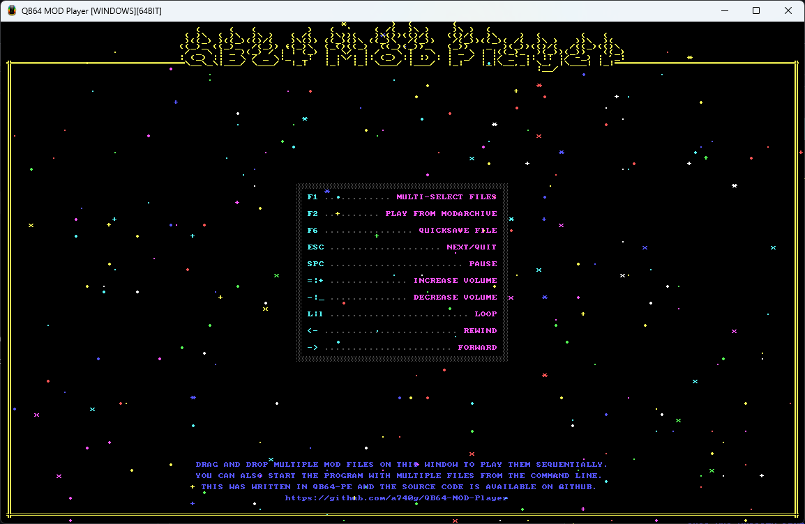

# QB64 MOD Player

A high-performance tracker music player and library written in [QB64-PE](https://www.qb64phoenix.com/).

Supports classic module formats:

- **MOD**: ProTracker, SoundTracker, StarTrekker (1 to 99 channels, AM synth)
- **S3M**: Scream Tracker 3 (digital audio + Yamaha OPL2/OPL3 AdLib FM)
- **MTM**: MultiTracker
- **669**: Composer 669
- **FAR**: Farandole Composer
- **STM**: Scream Tracker 2
- **RAD**: Reality Adlib Tracker (OPL2 FM)
- **ULT**: UltraTracker
- **MDL**: Digitrakker
- **AMF**: Advanced Music Format

---




## Features

- 100% pure BASIC code compiled without external DLLs or runtime dependencies (Windows, Linux, macOS).
- Multi-channel software mixing, volume/pan attenuation, frequency control, and Yamaha OPL2/OPL3 FM emulation.
- Real-time Radix-2 FFT spectral analysis, oscilloscope, VU meters, pattern display, and animated backgrounds.
- Multi-Instance API that supports independent playback instances concurrently without crosstalk.
- Independent core replayer engine with dedicated format loaders for each tracker standard.

## Quick Start

### Prerequisites

- [QB64-PE](https://github.com/QB64-Phoenix-Edition/QB64pe/releases/latest) (latest release)

### Building and Running

Using [Makefile](Makefile):

```sh
make          # Build QB64MODPlayer executable
make release  # Build with C++ compiler optimizations
make test     # Build and run the test suite
```

Or compiling directly with the QB64-PE CLI:

```sh
qb64pe -x -e -w source/QB64MODPlayer.bas
```

Run the generated `QB64MODPlayer` executable.

## Using the Library in Your Project

Include the replayer headers in your QB64-PE project:

```vb
$CONSOLE:ONLY
_DEFINE A-Z AS LONG
OPTION _EXPLICIT

'$INCLUDE:'source/MODPlayer.bm'

DIM Player AS MODPlayer

IF NOT MODPlayer_LoadFromDisk(Player, "mods/Enigma.mod") THEN
    PRINT "Failed to load module!"
    END
END IF

PRINT "Playing: "; MODPlayer_GetName(Player); " ["; MODPlayer_GetType(Player); "]"
MODPlayer_Play Player

DO WHILE MODPlayer_IsPlaying(Player)
    MODPlayer_Update Player, 0.05
    _LIMIT 60
LOOP

MODPlayer_Stop Player
MODPlayer_Finalize Player
SYSTEM
```

## Documentation

- **[API Reference](docs/API.md)**: Complete API documentation.
- **[References](docs/REFERENCES.md)**: Specification and tutorial references.

## License

- Licensed under the [MIT License](LICENSE.txt).
- Application icon by [Tsukasa-Tux](https://iconarchive.com/artist/tsukasa-tux.html).
