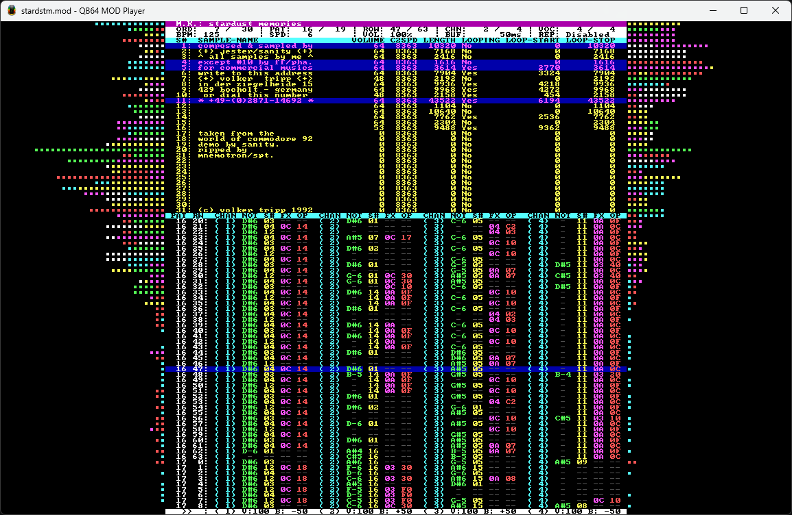

# QB64 MOD Player

A tracker music replayer and library written in [QB64-PE](https://www.qb64phoenix.com/).

It supports the following classic module formats:

- [ProTracker](https://en.wikipedia.org/wiki/ProTracker) (and compatibles, `.mod`)
- [MultiTracker](https://en.wikipedia.org/wiki/Module_file#Popular_formats) (`.mtm`)
- [Scream Tracker 3](https://en.wikipedia.org/wiki/Scream_Tracker) (`.s3m`)

---




## Features

- Pure native QB64-PE code statically compiled without shared libraries or runtime DLL requirements.
- Fully supported on Windows, Linux, and macOS.
- Format Support:
  - ProTracker MOD files with 1 to 99 channels, 15 or 31 samples, and Amiga period limits.
  - Scream Tracker 3 (S3M) files with multi-channel digital audio, custom sample rates, and ST3 panning.
  - MultiTracker (MTM) files with track sequencing and 8-bit PCM samples.
- Supports pitch slides, portamento, vibrato, tremolo, volume slides, arpeggio, sample offset, panning, pattern delay, and extended commands.
- Full-screen visualizer showcasing real-time FFT spectrum analysis, pattern viewers, and text-mode animations.

## Building and Running

### Prerequisites

- The latest version of [QB64-PE](https://github.com/QB64-Phoenix-Edition/QB64pe/releases).

### Method 1: Using the Makefile (Recommended)

A [Makefile](Makefile) is included for building with GNU Make or `mingw32-make`:

```sh
# Build the application (outputs QB64MODPlayer in root)
make

# Build with C++ compiler optimizations
make release

# Remove compiled executable
make clean

# Display help and usage information
make help
```

### Method 2: Command Line Compilation

Compile directly using the QB64-PE compiler:

```sh
qb64pe -x -w -e source/QB64MODPlayer.bas
```

Then run the generated `QB64MODPlayer` executable.

### Method 3: Using the QB64-PE IDE

1. Open `source/QB64MODPlayer.bas` in the QB64-PE IDE.
2. Press `F5` to compile and run.

## Using the Library in Your Project

1. Copy the [`source`](source/) directory into your project.
2. Include the library header in your source code:

   ```vb
   '$INCLUDE:'source/MODPlayer.bi'
   ```

### Quick Example

```vb
$CONSOLE:ONLY
_DEFINE A-Z AS LONG
OPTION _EXPLICIT

'$INCLUDE:'source/File.bi'
'$INCLUDE:'source/String.bi'
'$INCLUDE:'source/AudioAnalyzer.bi'
'$INCLUDE:'source/MODPlayer.bi'

IF NOT MODPlayer_LoadFromDisk("mods/Enigma.mod") THEN
    PRINT "Failed to load module!"
    END
END IF

PRINT "Playing: "; MODPlayer_GetName
PRINT "Format:  "; MODPlayer_GetType

MODPlayer_Play

DO WHILE MODPlayer_IsPlaying
    MODPlayer_Update 0.05
    _LIMIT 60
LOOP

MODPlayer_Stop
SYSTEM
```

## API Reference

<!-- markdownlint-disable MD013 -->
```vb
' -----------------------------------------------------------------------------
' Main Player API (MODPlayer.bi)
' -----------------------------------------------------------------------------
FUNCTION MODPlayer_LoadFromDisk%% (fileName AS STRING)
FUNCTION MODPlayer_LoadFromMemory%% (buffer AS STRING)
SUB MODPlayer_Play
SUB MODPlayer_Stop
SUB MODPlayer_Pause (state AS _BYTE)
FUNCTION MODPlayer_IsPlaying%%
FUNCTION MODPlayer_IsPaused%%
SUB MODPlayer_Loop (state AS _BYTE)
FUNCTION MODPlayer_IsLooping%%
SUB MODPlayer_Update (bufferTimeSecs AS SINGLE)
FUNCTION MODPlayer_GetName$
FUNCTION MODPlayer_GetType$
FUNCTION MODPlayer_GetPosition&
FUNCTION MODPlayer_GetOrders~%
SUB MODPlayer_SetPosition (position AS _UNSIGNED INTEGER)
SUB MODPlayer_GoToNextPosition
SUB MODPlayer_GoToPreviousPosition

' -----------------------------------------------------------------------------
' Software Synthesizer / Sample Mixer API (SoftSynth.bi)
' -----------------------------------------------------------------------------
FUNCTION SoftSynth_Initialize%% (ctx AS SoftSynthType)
SUB SoftSynth_Finalize (ctx AS SoftSynthType)
FUNCTION SoftSynth_IsInitialized%% (ctx AS SoftSynthType)
SUB SoftSynth_LoadSound (ctx AS SoftSynthType, snd AS LONG, buffer AS STRING, bytesPerSample AS _UNSIGNED _BYTE, channels AS _UNSIGNED _BYTE)
FUNCTION SoftSynth_ConvertBytesToFrames~& (bytes AS _UNSIGNED LONG, bytesPerSample AS _UNSIGNED _BYTE, channels AS _UNSIGNED _BYTE)
SUB SoftSynth_PlayVoice (ctx AS SoftSynthType, voice AS _UNSIGNED LONG, snd AS LONG, position AS _UNSIGNED LONG, mode AS LONG, startPosition AS _UNSIGNED LONG, endPosition AS _UNSIGNED LONG)
SUB SoftSynth_StopVoice (ctx AS SoftSynthType, voice AS _UNSIGNED LONG)
SUB SoftSynth_Update (ctx AS SoftSynthType, frames AS _UNSIGNED LONG)
FUNCTION SoftSynth_GetActiveVoices~& (ctx AS SoftSynthType)
FUNCTION SoftSynth_GetTotalVoices~& (ctx AS SoftSynthType)
SUB SoftSynth_SetTotalVoices (ctx AS SoftSynthType, voices AS _UNSIGNED LONG)
FUNCTION SoftSynth_GetTotalSounds~& (ctx AS SoftSynthType)
FUNCTION SoftSynth_GetSampleRate~& (ctx AS SoftSynthType)
FUNCTION SoftSynth_GetBufferedSoundTime# (ctx AS SoftSynthType)
FUNCTION SoftSynth_GetMasterVolume! (ctx AS SoftSynthType)
SUB SoftSynth_SetMasterVolume (ctx AS SoftSynthType, volume AS SINGLE)
FUNCTION SoftSynth_GetGlobalVolume! (ctx AS SoftSynthType)
SUB SoftSynth_SetGlobalVolume (ctx AS SoftSynthType, volume AS SINGLE)
FUNCTION SoftSynth_GetVoiceVolume! (ctx AS SoftSynthType, voice AS _UNSIGNED LONG)
SUB SoftSynth_SetVoiceVolume (ctx AS SoftSynthType, voice AS _UNSIGNED LONG, volume AS SINGLE)
FUNCTION SoftSynth_GetVoiceBalance! (ctx AS SoftSynthType, voice AS _UNSIGNED LONG)
SUB SoftSynth_SetVoiceBalance (ctx AS SoftSynthType, voice AS _UNSIGNED LONG, balance AS SINGLE)
FUNCTION SoftSynth_GetVoiceFrequency~& (ctx AS SoftSynthType, voice AS _UNSIGNED LONG)
SUB SoftSynth_SetVoiceFrequency (ctx AS SoftSynthType, voice AS _UNSIGNED LONG, frequency AS _UNSIGNED LONG)
FUNCTION SoftSynth_PeekSoundFrameByte%% (ctx AS SoftSynthType, snd AS LONG, position AS _UNSIGNED LONG)
FUNCTION SoftSynth_PeekSoundFrameInteger% (ctx AS SoftSynthType, snd AS LONG, position AS _UNSIGNED LONG)
FUNCTION SoftSynth_PeekSoundFrameSingle! (ctx AS SoftSynthType, snd AS LONG, position AS _UNSIGNED LONG)
SUB SoftSynth_PokeSoundFrameByte (ctx AS SoftSynthType, snd AS LONG, position AS _UNSIGNED LONG, frame AS _BYTE)
SUB SoftSynth_PokeSoundFrameInteger (ctx AS SoftSynthType, snd AS LONG, position AS _UNSIGNED LONG, frame AS INTEGER)
SUB SoftSynth_PokeSoundFrameSingle (ctx AS SoftSynthType, snd AS LONG, position AS _UNSIGNED LONG, frame AS SINGLE)
```
<!-- markdownlint-enable MD013 -->

## Frequently Asked Questions

### Why create a MOD player in QB64?

Just for learning and fun! While there are many tracker replayers written in C
and C++, very few exist in high-level BASIC dialects. Having grown up coding on
DOS using QuickBASIC before moving to C and C++, QuickBASIC has always held a
special place in my heart. This project explores how far pure QB64-PE can be
pushed in digital signal processing and sound synthesis.

### Can this library be used in games or demos?

Yes! The library is designed specifically for plug-and-play integration into
demos, games, and multimedia tools. The included visualizer demo demonstrates
how to query song states, visualize audio, and render graphics in sync with
playback.

### How does this compare to QB64-PE's built-in audio engine?

Recent versions of QB64-PE include built-in tracker playback via the miniaudio
and Libxmp-lite backend. Libxmp-lite is great for general playback, but this
project is a pure QB64-PE implementation designed for learning, transparency,
and full hackability directly within BASIC code.

### Can you implement a specific feature or format?

Feature additions are guided by available free time and personal interest. If
you need a specific feature or format enhancement, feel free to open a GitHub
issue or submit a pull request!

### I found a bug. How can I report it?

Please report any issues or edge cases using the
[GitHub issue tracker](https://github.com/a740g/QB64-MOD-Player/issues), or
submit a pull request with a fix.

## References and Documentation

<!-- markdownlint-disable MD013 -->
- [MOD Player Tutorial](docs/FMODDOC.TXT) by *FireLight*
- [S3M Player Tutorial](docs/FS3MDOC.TXT) by *FireLight*
- [Noisetracker/Soundtracker/Protracker Module Format](docs/MOD-FORM.TXT) by *Andrew Scott*
- [MODFIL10.TXT](docs/MODFIL10.TXT) by *Thunder*
- [Protracker Module](https://wiki.multimedia.cx/index.php/Protracker_Module) from *MultimediaWiki*
- [Scream Tracker 3 Module](https://wiki.multimedia.cx/index.php/Scream_Tracker_3_Module) from *MultimediaWiki*
- [S3M Format](https://moddingwiki.shikadi.net/wiki/S3M_Format) by *ModdingWiki*
- [Scream Tracker 3 module](http://fileformats.archiveteam.org/wiki/Scream_Tracker_3_module) from *Solve the File Format Problem*
- [MultiTracker Module (MTM) Format](docs/MultiTracker%20(.mtm).txt) by *Renaissance*
- [Manual: Effect Reference](https://wiki.openmpt.org/Manual:_Effect_Reference) from *OpenMPT Wiki*
- [Weasel audio library](https://weaselaudiolib.sourceforge.net/) by *Warren Willmey*
- [Digital Audio Mixing Techniques](docs/FSBDOC.TXT) by *jedi / oxygen*
- [Writing Mixing Routines](docs/MIXING10.TXT) by *BYTERAVER/TNT*
- [Audio Mixer Tutorial](docs/mixer_tutorial) by *benhenshaw*
<!-- markdownlint-enable MD013 -->

## Assets and License

- **Project License**: Licensed under the [MIT License](LICENSE.txt).
- **Application Icon**: Created by [Tsukasa-Tux (Azrael Jackie Lockheart)](https://iconarchive.com/artist/tsukasa-tux.html).
