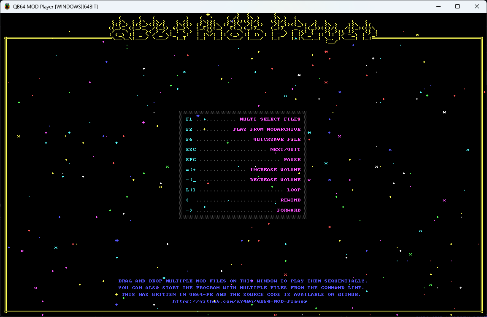
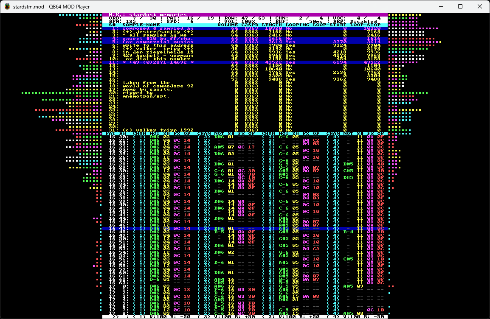

# QB64 MOD PLAYER

This is a [MOD](https://en.wikipedia.org/wiki/MOD_(file_format)) player and library written in [QB64-PE](https://www.qb64phoenix.com/).

It currently supports the following formats:

- [ProTracker](https://en.wikipedia.org/wiki/ProTracker) (and compatible)
- [MultiTracker](https://en.wikipedia.org/wiki/Module_file#Popular_formats)
- [Scream Tracker 3](https://en.wikipedia.org/wiki/Scream_Tracker)

---




## FEATURES

- No dependency on third-party libraries
- Everything is statically linked (no shared library dependency)
- Easy plug-&-play API optimized for demos & games
- Cross-platform (works on Windows, Linux & macOS)
- Support all MOD types (1 - 99 channels, 31 samples, etc.)
- Support all MOD effects
- Demo player that shows how to use the library

## USAGE

### Running the Demo Player

1. Clone the repository:

   ```sh
   git clone https://github.com/a740g/QB64-MOD-Player.git
   cd QB64-MOD-Player
   ```

2. Build and run using either method:
   - **QB64-PE IDE:** Open `QB64MODPlayer.bas` in the IDE and press `F5`.
   - **Command Line:** Compile directly with the QB64-PE compiler:

     ```sh
     qb64pe -x -w -e QB64MODPlayer.bas
     ```

     Then run the generated executable.

### Using the Library in Your Project

1. Copy the `source` directory into your project.
2. Include the library in your code:

   ```vb
   '$INCLUDE:'source/MODPlayer.bi'
   ```

## API

```vb
' Main Player API
FUNCTION MODPlayer_GetName$
FUNCTION MODPlayer_GetOrders~%
FUNCTION MODPlayer_GetPosition&
FUNCTION MODPlayer_GetType$
SUB MODPlayer_GoToNextPosition
SUB MODPlayer_GoToPreviousPosition
FUNCTION MODPlayer_IsLooping%%
FUNCTION MODPlayer_IsPaused%%
FUNCTION MODPlayer_IsPlaying%%
FUNCTION MODPlayer_LoadFromDisk%% (fileName AS STRING)
FUNCTION MODPlayer_LoadFromMemory%% (buffer AS STRING)
SUB MODPlayer_Loop (state AS _BYTE)
SUB MODPlayer_Pause (state AS _BYTE)
SUB MODPlayer_Play
SUB MODPlayer_SetPosition (position AS _UNSIGNED INTEGER)
SUB MODPlayer_Stop
SUB MODPlayer_Update (bufferTimeSecs AS SINGLE)

' Sample Mixer API
FUNCTION SoftSynth_ConvertBytesToFrames~& (bytes AS _UNSIGNED LONG, bytesPerSample AS _UNSIGNED _BYTE, channels AS _UNSIGNED _BYTE)
SUB SoftSynth_Finalize (ctx AS SoftSynthType)
FUNCTION SoftSynth_GetActiveVoices~& (ctx AS SoftSynthType)
FUNCTION SoftSynth_GetBufferedSoundTime# (ctx AS SoftSynthType)
FUNCTION SoftSynth_GetGlobalVolume! (ctx AS SoftSynthType)
FUNCTION SoftSynth_GetMasterVolume! (ctx AS SoftSynthType)
FUNCTION SoftSynth_GetSampleRate~& (ctx AS SoftSynthType)
FUNCTION SoftSynth_GetTotalSounds~& (ctx AS SoftSynthType)
FUNCTION SoftSynth_GetTotalVoices~& (ctx AS SoftSynthType)
FUNCTION SoftSynth_GetVoiceBalance! (ctx AS SoftSynthType, voice AS _UNSIGNED LONG)
FUNCTION SoftSynth_GetVoiceFrequency~& (ctx AS SoftSynthType, voice AS _UNSIGNED LONG)
FUNCTION SoftSynth_GetVoiceVolume! (ctx AS SoftSynthType, voice AS _UNSIGNED LONG)
FUNCTION SoftSynth_Initialize%% (ctx AS SoftSynthType)
FUNCTION SoftSynth_IsInitialized%% (ctx AS SoftSynthType)
SUB SoftSynth_LoadSound (ctx AS SoftSynthType, snd AS LONG, buffer AS STRING, bytesPerSample AS _UNSIGNED _BYTE, channels AS _UNSIGNED _BYTE)
FUNCTION SoftSynth_PeekSoundFrameByte%% (ctx AS SoftSynthType, snd AS LONG, position AS _UNSIGNED LONG)
FUNCTION SoftSynth_PeekSoundFrameInteger% (ctx AS SoftSynthType, snd AS LONG, position AS _UNSIGNED LONG)
FUNCTION SoftSynth_PeekSoundFrameSingle! (ctx AS SoftSynthType, snd AS LONG, position AS _UNSIGNED LONG)
SUB SoftSynth_PlayVoice (ctx AS SoftSynthType, voice AS _UNSIGNED LONG, snd AS LONG, position AS _UNSIGNED LONG, mode AS LONG, startPosition AS _UNSIGNED LONG, endPosition AS _UNSIGNED LONG)
SUB SoftSynth_PokeSoundFrameByte (ctx AS SoftSynthType, snd AS LONG, position AS _UNSIGNED LONG, frame AS _BYTE)
SUB SoftSynth_PokeSoundFrameInteger (ctx AS SoftSynthType, snd AS LONG, position AS _UNSIGNED LONG, frame AS INTEGER)
SUB SoftSynth_PokeSoundFrameSingle (ctx AS SoftSynthType, snd AS LONG, position AS _UNSIGNED LONG, frame AS SINGLE)
SUB SoftSynth_SetGlobalVolume (ctx AS SoftSynthType, volume AS SINGLE)
SUB SoftSynth_SetMasterVolume (ctx AS SoftSynthType, volume AS SINGLE)
SUB SoftSynth_SetTotalVoices (ctx AS SoftSynthType, voices AS _UNSIGNED LONG)
SUB SoftSynth_SetVoiceBalance (ctx AS SoftSynthType, voice AS _UNSIGNED LONG, balance AS SINGLE)
SUB SoftSynth_SetVoiceFrequency (ctx AS SoftSynthType, voice AS _UNSIGNED LONG, frequency AS _UNSIGNED LONG)
SUB SoftSynth_SetVoiceVolume (ctx AS SoftSynthType, voice AS _UNSIGNED LONG, volume AS SINGLE)
SUB SoftSynth_StopVoice (ctx AS SoftSynthType, voice AS _UNSIGNED LONG)
SUB SoftSynth_Update (ctx AS SoftSynthType, frames AS _UNSIGNED LONG)
```

## FAQ

**Why a MOD player in QB64?**

- Just for learning and fun! Long answer: I have seen plenty of MOD players code and libraries in C & C++ but very little in other languages. I know about some JavaScript, Java and C# ones. But, I am not a fan of those languages. I learnt to code on DOS using QuickBASIC and then graduated to C & C++. So, QuickBASIC always had a special place in my heart. Then, I found QB64 on the internet and the rest is history. As far as I know this is the first of its kind. Let me know if there are any other MOD players written in pure QB64.

**Can you implement feature x / y?**

- With the limited time I have between my day job, home and family, there is only so much I can do. There are no set deadlines. If you need something implemented, submit a GitHub issue about it or do it yourself and submit a PR.

**I found a bug. How can I help?**

- Let me know using GitHub issues or fix it yourself and submit a PR!

**Can this be used in a game / demo?**

- Absolutely. The player UI code included is a great example.

**You keep saying QB64-PE with miniaudio backend. Where is it?**

- Glad you asked! IT, XM, S3M & MOD support is built into [QB64-PE v3.1.0+](https://github.com/QB64-Phoenix-Edition/QB64pe/releases/).

**I see that the miniaudio backend version of QB64-PE already has MOD, S3M, XM, IT, RADv2 & MIDI support. Why should I care about this?**

- Honestly, you should not! The MOD re-player in QB64-PE with miniaudio backend uses [Libxmp-lite](https://github.com/libxmp/libxmp/tree/master/lite) and as such is good enough for most use cases. This is just something that I made just to see what can be done using just QB64-PE. If you want to see what MOD files are made of and what makes them tick, then by all means, have at it. There are some interesting things in the code for people who care about this kind of stuff. Also, my MOD re-player is more accurate than the one in Libxmp-lite... I hope. 😉

## NOTES

- This requires the latest version of [QB64-PE](https://github.com/QB64-Phoenix-Edition/QB64pe/releases).

## BIBLIOGRAPHY

- [MOD Player Tutorial](docs/FMODDOC.TXT) by *FireLight*
- [S3M Player Tutorial](docs/FS3MDOC.TXT) by *FireLight*
- [Noisetracker/Soundtracker/Protracker Module Format](docs/MOD-FORM.TXT) by *Andrew Scott*
- [MODFIL10.TXT](docs/MODFIL10.TXT) by *Thunder*
- [Protracker Module](https://wiki.multimedia.cx/index.php/Protracker_Module) from *MultimediaWiki*
- [Scream Tracker 3 Module](https://wiki.multimedia.cx/index.php/Scream_Tracker_3_Module) from *MultimediaWiki*
- [S3M Format](https://moddingwiki.shikadi.net/wiki/S3M_Format) by *ModdingWiki*
- [Scream Tracker 3 module](http://fileformats.archiveteam.org/wiki/Scream_Tracker_3_module) from *Solve the File Format Problem*
- [MultiTracker Module (MTM) Format](docs/MultiTracker%20(.mtm).txt) by *Renaissance*
- [Manual: Effect Reference](https://wiki.openmpt.org/Manual:_Effect_Reference) from *OpenMPT Wiki*
- [Weasel audio library](https://weaselaudiolib.sourceforge.net/) by Warren Willmey
- [Digital Audio Mixing Techniques](docs/FSBDOC.TXT) by *jedi / oxygen*
- [Writing Mixing Routines](docs/MIXING10.TXT) by *BYTERAVER/TNT*
- [Audio Mixer Tutorial](docs/mixer_tutorial) by *benhenshaw*

## ASSETS

- [Icon](https://iconarchive.com/artist/tsukasa-tux.html) by *Tsukasa-Tux (Azrael Jackie Lockheart)*
